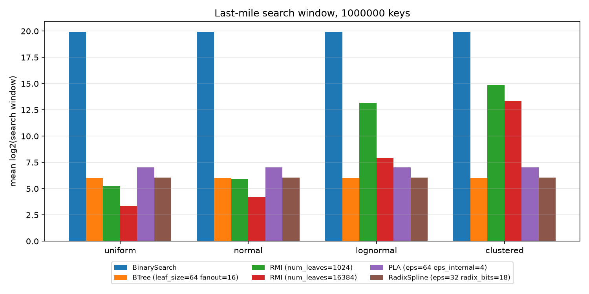

# lindex

Learned index structures for sorted, in-memory data, implemented in plain
Python + numpy and compared against classic baselines on synthetic key
distributions (and on SOSD data, if you have it locally).

The goal is not speed. The goal is a small, readable codebase where each
structure fits in one file, every lookup is checked against `bisect`, and
the quantity that drives lookup cost (the size of the last-mile search
window) can be measured directly.

## What is implemented

| structure | file | idea | reference |
|---|---|---|---|
| Binary search | `lindex/binary_search.py` | baseline, no extra space | - |
| B+-tree | `lindex/btree.py` | static, bulk-loaded, implicit layout | Comer 1979 |
| RMI | `lindex/rmi.py` | 2-stage recursive model index, linear models | Kraska et al. 2018 |
| PLA index | `lindex/pla.py` | error-bounded piecewise linear segments (shrinking cone), indexed recursively | Galakatos et al. 2019; Ferragina & Vinciguerra 2020 |
| RadixSpline | `lindex/radix_spline.py` | error-bounded spline + radix table on key prefixes | Kipf et al. 2020 |

All structures implement the same interface (`lindex/base.py`):

```python
index = RMI(num_leaves=1024).build(keys)   # keys: sorted, unique ints
index.lower_bound(key)                     # first position with keys[pos] >= key
index.search_window(key)                   # (lo, hi): where the answer must be
index.size_bytes()
```

Design decisions and the error-bound arguments are written up in
[`docs/design.md`](docs/design.md).

## Quick start

```bash
pip install -r requirements.txt
python -m pytest -q                      # ~200 tests, a few seconds
python scripts/run_benchmarks.py         # 1M keys x 4 distributions
python scripts/plot_results.py results/results.csv
```

Real data sets in the SOSD binary format (uint64 count followed by uint64
keys) can be added with
`python scripts/run_benchmarks.py --sosd data/books_200M_uint64 --keys 10000000`.

## Data sets

`lindex/datasets.py` generates sorted, unique keys below 2^53:

* `uniform`: uniform in [0, 2^50)
* `normal`: Gaussian, very dense in the middle
* `lognormal`: sigma = 2, a heavy right tail (most keys are small)
* `clustered`: 64 Gaussian clusters with very different widths and
  weights, as a stand-in for data with strong local structure

## Results

One run, 1M keys per data set, 100k lookups of existing keys (sampled
uniformly), single thread, CPython 3 on a laptop. Raw numbers are in
[`results/results.csv`](results/results.csv).

### Last-mile search window

Mean `log2(window size)`, i.e. roughly the number of binary search steps
left after the index has done its work. Lower is better. This number is
deterministic and does not depend on the machine.

| index | params | size (KiB) | uniform | normal | lognormal | clustered |
|---|---|---:|---:|---:|---:|---:|
| BinarySearch | - | 0.0 | 19.93 | 19.93 | 19.93 | 19.93 |
| BTree | leaf_size=64 fanout=16 | 260.4 | 6.02 | 6.02 | 6.02 | 6.02 |
| RMI | num_leaves=1024 | 40.0 | 5.22 | 5.95 | 13.18 | 14.87 |
| RMI | num_leaves=16384 | 640.0 | 3.35 | 4.21 | 7.93 | 13.36 |
| PLA | eps=64 eps_internal=4 | 2.2 - 13.6 | 7.04 | 7.04 | 7.03 | 7.01 |
| RadixSpline | eps=32 radix_bits=18 | 649.3 - 1037.1 | 6.06 | 6.06 | 6.06 | 6.04 |



### Lookup latency (ns)

| index | params | uniform | normal | lognormal | clustered |
|---|---|---:|---:|---:|---:|
| BinarySearch | - | 516 | 827 | 867 | 506 |
| BTree | leaf_size=64 fanout=16 | 1243 | 2351 | 1930 | 1255 |
| RMI | num_leaves=1024 | 877 | 1454 | 1810 | 1163 |
| RMI | num_leaves=16384 | 829 | 1282 | 1479 | 1167 |
| PLA | eps=64 eps_internal=4 | 2158 | 3998 | 2536 | 2230 |
| RadixSpline | eps=32 radix_bits=18 | 2249 | 1883 | 1110 | 1090 |

Take these with a large grain of salt. Repeated runs on the same machine
differ by up to ~50% for some cells, and the ranking among the Python
structures is mostly a count of how many interpreted lines a lookup
executes.

### Observations

1. **In CPython, `bisect` wins on latency.** It is a single C call. Every
   other structure pays interpreter overhead per level and per model
   evaluation, which costs more than the ~14 binary search steps it saves.
   This is the opposite of what the papers report for C++, and it is the
   reason the window size is the main metric here.
2. **Error-bounded structures behave the same on every distribution.**
   PLA and RadixSpline keep their window at about `log2(2 * eps + 3)` on
   all four data sets. What changes with the distribution is their
   *size*: PLA needs about 6x more space on `clustered` than on `uniform`
   (13.6 KiB vs 2.2 KiB), which is still tiny next to the B+-tree's 260 KiB.
3. **The RMI is the most sensitive to the data.** With a linear root, it
   has the smallest windows of all on `uniform` and `normal`, but on
   `lognormal` and `clustered` most keys are routed to a few leaves, and
   16x more leaves barely help on `clustered` (14.87 -> 13.36). The root
   model is the bottleneck, which matches the motivation for the
   non-linear and radix root models in SOSD and CDFShop.
4. **RadixSpline's size is the radix table.** At 18 bits the table takes
   ~1 MiB, while the spline needs only ~800-1,300 points (13-21 KiB).
   The paper tunes the radix bits per data set; with a fixed setting the
   table dominates the size.

## Repository layout

```
lindex/          the package: indexes, datasets, benchmark harness
tests/           pytest suite; every index is checked against bisect
scripts/         run_benchmarks.py, plot_results.py
docs/design.md   design notes and open questions
results/         numbers and plots from the run above
```

## References

* D. Comer. The Ubiquitous B-Tree. *ACM Computing Surveys*, 11(2), 1979.
* T. Kraska, A. Beutel, E. H. Chi, J. Dean, N. Polyzotis. The Case for
  Learned Index Structures. *SIGMOD* 2018.
* A. Galakatos, M. Markovitch, C. Binnig, R. Fonseca, T. Kraska.
  FITing-Tree: A Data-aware Index Structure. *SIGMOD* 2019.
* P. Ferragina, G. Vinciguerra. The PGM-index: a fully-dynamic compressed
  learned index with provable worst-case bounds. *PVLDB* 13(8), 2020.
* A. Kipf, R. Marcus, A. van Renen, M. Stoian, A. Kemper, T. Kraska,
  T. Neumann. RadixSpline: A Single-Pass Learned Index. *aiDM@SIGMOD* 2020.
* T. Neumann, S. Michel. Smooth Interpolating Histograms with Error
  Guarantees. *BNCOD* 2008.
* A. Kipf, R. Marcus, A. van Renen, M. Stoian, A. Kemper, T. Kraska,
  T. Neumann. SOSD: A Benchmark for Learned Indexes. *ML for Systems
  workshop at NeurIPS* 2019.
* R. Marcus, A. Kipf, A. van Renen, M. Stoian, S. Misra, A. Kemper,
  T. Neumann, T. Kraska. Benchmarking Learned Indexes. arXiv:2006.12804,
  2020.
* R. Marcus, E. Zhang, T. Kraska. CDFShop: Exploring and Optimizing
  Learned Index Structures. *SIGMOD* 2020 (demo).
* J. Ding et al. ALEX: An Updatable Adaptive Learned Index. *SIGMOD* 2020.

## License

MIT, see [LICENSE](LICENSE).
